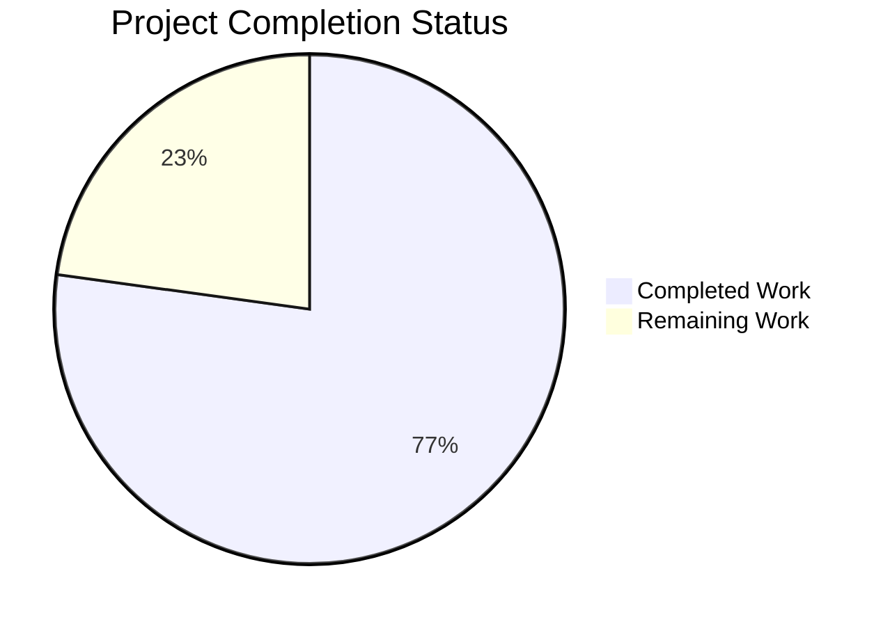
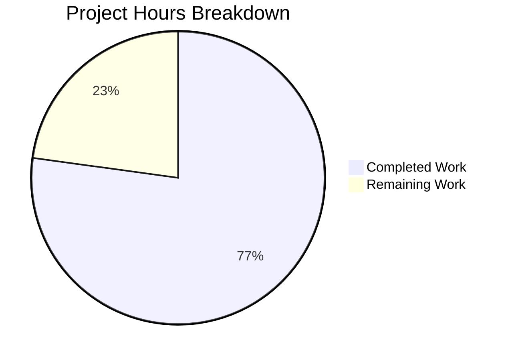

# 1. Executive Summary

A dependency-free Node.js HTTP server in three files, with one served route and a fixed plain-text fallback, built to be read as much as run.

## 1.1 Project Overview

Three files at the repository root are the whole deliverable: `server.js` (the application, 134 lines), `package.json` (the manifest — seven fields, no dependency key) and `README.md` (eight documentation sections). `GET /hello` returns `200` with `Content-Type: text/plain` and the body `Hello world`; every other request returns `404` with the body `Not Found`. No framework, middleware, router, database, stored data or dependency of any kind is involved.

The audience is a developer learning Node.js HTTP fundamentals, and a reviewer wanting a framework-free reference for hand-written routing, headers, logging and a clean shutdown.

## 1.2 Completion Status



| Metric | Hours |
| --- | --- |
| Total Hours | 46.0 |
| Completed Hours (AI + Manual) | 35.5 |
| Remaining Hours | 10.5 |

**77% complete** — 35.5 of 46.0 total project hours (35.5 / 46.0 × 100 = 77.17%, reported as 77%). Completed covers every deliverable the specification defines for the three files plus the acceptance runs that prove them; remaining covers the open items in 1.4, costed in 2.2.

## 1.3 Key Accomplishments

- `GET /hello` answers `200` with `Content-Type: text/plain` and an 11-byte `Hello world` body, verified over curl, raw sockets and a real browser
- Every other request — unknown paths and method mismatches alike — answers `404` with a 9-byte `Not Found`; a query string does not defeat the route match
- One ISO-8601 line per request is written before routing, carrying the method and the request target as received
- An invalid `PORT`, an unbindable port and `CTRL+C` each behave exactly as documented, with exit status `1`, `1` and `0` respectively

## 1.4 Critical Unresolved Issues

**11 open items of the 25 requirements tracked for this project.** None blocks the two routes; the first two affect operator behaviour and should be settled before release.

| Issue | Impact | Owner | ETA |
| --- | --- | --- | --- |
| Declared runtime floor `>=18.0.0` names an end-of-life release line, and the shutdown path was exercised only on the reference runtime (1 item) | On Node v18.0.0/v18.1.x neither connection sweep exists, so a shutdown with an idle keep-alive socket can take up to `server.keepAliveTimeout` (~5 s) instead of completing at once | Codebase owner | Before release |
| The close-failure line `Failed to close server: <message>` (`server.js:95`) is implemented but no longer reachable in normal operation (1 item) | A future regression on that branch would go unnoticed until a real close failure occurs | Codebase owner | Next maintenance window |
| The engine floor is documentation only: npm reports a mismatch as `EBADENGINE` and does not enforce it (1 item) | An operator can run the server on an unsupported runtime without a hard failure | Codebase owner | With the floor decision |
| Two implementation choices depart from the implementation specification and await a recorded decision — the extra guarded `server.closeAllConnections()` call and the single module-level `shuttingDown` flag (2 items) | Unrecorded departures are read later as defects; both are required by the exit-status-0 shutdown contract | Codebase owner | Before release |
| The project's review instruction calls for a project-notes document that does not exist in the repository (1 item) | Guidance those notes were meant to carry never reached this work | Codebase owner | Before release |
| The server binds every network interface and has no authentication, by design and now disclosed in `README.md:52` (1 item) | Any host that can reach the machine on the chosen port can call both routes | Operator | Before exposing beyond a trusted network |
| The Testing and Configuration sections omit the occupied-port message and a query-string `curl` example (1 item) | A reader troubleshooting a busy port, or testing the query-string behaviour, finds no worked example | Codebase owner | Next documentation pass |
| A `HEAD` response carries no `Content-Length` (the runtime omits it for a body-suppressed response) (1 item) | A client that insists on reading a body waits for its own timeout | None — accepted runtime behaviour | N/A |
| Requests the runtime's HTTP parser rejects (`400`/`431`) never reach the listener, so they produce no request log line (1 item) | The log records every request the application receives, not every byte on the socket | None — accepted runtime behaviour | N/A |
| A `SIGINT` delivered in the first milliseconds, before the signal listener is installed, terminates the process by default disposition with no output (1 item) | A signal sent the instant the process starts produces no shutdown lines | None — accepted runtime behaviour | N/A |

## 1.5 Access Issues

No access issues identified: no credential, secret, environment variable, database, cache or external service is required, and both routes are reachable on `localhost` after `node server.js`.

## 1.6 Recommended Next Steps

1. [High] Settle the runtime floor: verify shutdown on Node v18.0.0/v18.1.x, or raise the floor and README prerequisite to a supported LTS line (4.0 h)
2. [Medium] Close the close-failure coverage gap and decide the two specification departures (3.0 h)
3. [Medium] Supply the project-notes guidance the review instruction anticipates, or waive it in writing (1.0 h)
4. [Low] Add the occupied-port message and a query-string example to the README (1.0 h)
5. [Low] Re-run the documented acceptance commands on a second runtime and a non-Linux host (1.5 h)

# 2. Project Hours Breakdown

## 2.1 Completed Work Detail

| Component | Hours | Description |
| --- | --- | --- |
| `package.json` manifest | 1.5 | Seven fields with their exact values, the empty package set expressed by the absent dependency key, the engine floor, and `main`/`scripts.start` pointing at the entry file |
| Server creation, listeners and startup sequence | 2.5 | `http.createServer(handleRequest)`, the bind-error listener registered before `listen`, the signal listener installed before serving, and the confirmation emitted only from the listening callback |
| `GET /hello` route and the shared response path | 2.0 | One helper sets the status, the single `Content-Type` header and the body for both shapes, so no branch can set them differently |
| Catch-all `404`, method mismatch, pathname resolution and the malformed-target branch | 3.0 | An exact method-and-pathname match behind a pathname parse that tolerates a query string and answers the fixed `404` for a target the URL parser rejects |
| Per-request logging | 1.0 | One ISO-8601 line per request on stdout, written before the path is resolved and before any handler runs, carrying the target as received |
| `PORT` rule | 3.0 | Default for unset, empty or whitespace-only; a single trim; digits only; inclusive `1024`–`65535`; privileged ports refused by the floor before any bind attempt; one actionable message per refusal |
| Bind-failure reporting | 2.0 | The occupied-port line naming the port and a next step, the generic form for every other bind failure, exit status `1` and no stack trace |
| SIGINT shutdown path | 4.0 | Close, the two guarded connection sweeps, the idempotence guard, the two shutdown lines in order, and exit status `0` set rather than forced |
| `README.md` documentation | 4.5 | Eight sections in order with literal commands and expected outputs a zero-knowledge reader can follow end to end |
| Reported security finding disposition | 1.5 | The finding assessed against the deliverable, determined not applicable, and verified as an absence of any surface it names, with nothing added for it |
| Acceptance runs and runtime verification | 8.5 | Contract, logging, latency distribution, concurrency, memory and descriptor stability, the port matrix, both bind failures, the shutdown matrix, `npm start`, the documentation greps and the browser pass |
| Deliverable-set discipline and hygiene | 1.5 | Exactly three files, zero declared packages, no lockfile or `node_modules`, no placeholder or trailing-whitespace marker, no dead code |
| **Total** | **35.5** | Matches Completed Hours in 1.2 |

Hours are counted only for the deliverables the specification defines for this three-file server and for the path-to-production work that follows from them. Nothing outside that scope — build pipelines, containers, monitoring, health endpoints, extra routes, databases, authentication — is counted, because none is part of this project.

## 2.2 Remaining Work Detail

| Category | Hours | Priority |
| --- | --- | --- |
| Runtime floor: verify the shutdown and keep-alive behaviour on the declared Node v18.0.0/v18.1.x, or raise the declared floor to a supported LTS line and update the README prerequisite | 4.0 | High |
| Close-failure coverage: exercise `Failed to close server: <message>` (`server.js:95`) with a deterministic check, or record it as an accepted coverage gap | 2.0 | Medium |
| Decision record for the two implementation choices that go beyond the specification — the extra guarded connection sweep and the module-level shutdown flag | 1.0 | Medium |
| Project-notes guidance the review instruction anticipates: supply the document or waive the requirement in writing | 1.0 | Medium |
| Documentation completeness: add the occupied-port message and a query-string `curl` example to the README's Testing and Configuration sections | 1.0 | Low |
| Cross-runtime and cross-platform reassurance: re-run the documented acceptance commands on a second supported runtime line and on a non-Linux host | 1.5 | Low |
| **Total** | **10.5** | Matches Remaining Hours in 1.2 and the "Remaining Work" slice in Section 7 |

**Basis of the calculation.** The completed figure is the sum of the component estimates above, each traced to a deliverable the specification defines and each corroborated by the delivered code size (318 lines added over the base commit) and by the acceptance runs the specification requires. The remaining figure is the sum of the outstanding items, each traced to a specific requirement or to a path-to-production need; nothing outside the project's scope is included. Completion = 35.5 completed ÷ 46.0 total = **77%**.

# 3. Test Results

The project ships no test framework and may not add one — the manifest declares zero packages and the deliverable set is fixed at three files — so the suite is the set of documented acceptance commands in Appendix A, run by hand. Every number below was produced by a run of those commands against the delivered tree; no figure is an estimate.

| Area / Category | Framework | Tests | Passed | Failed | Coverage | What This Proves |
| --- | --- | --- | --- | --- | --- | --- |
| HTTP contract and routing | `curl` + shell assertions | 10 route, method and byte-count assertions | 10 | 0 | Not measured — no coverage tooling is installed | `GET /hello` answers `200`/`text/plain`/11 bytes, every other request answers `404`/`text/plain`/9 bytes, and a query string does not defeat the match |
| Per-request logging | `curl` + format grep on the capture | 13 request lines asserted | 13 | 0 | Not measured | One ISO-8601 line per request, in arrival order, before routing, carrying the target as received |
| Configuration and port validation | shell exit-status gate | 14 cases (9 refused, 5 accepted) | 14 | 0 | Not measured | The default, the trim rule, the range and the refusal of privileged ports, each with one actionable line |
| Bind-failure reporting | shell exit-status gate + controlled occupier | 2 cases (`EADDRINUSE`, resource-exhaustion bind failure) | 2 | 0 | Not measured | Both message forms, exit status `1`, nothing bound and no stack trace |
| SIGINT shutdown | shell exit-status gate + raw socket clients | 4 client states (none, idle keep-alive, unterminated request head, zero-byte socket) plus a repeated signal | 5 | 0 | Not measured | Two lines in order, connections closed, stderr empty and exit status `0` in every state |
| Startup, manifest and `npm start` | shell gate + JSON probe | 3 assertions | 3 | 0 | Not measured | The startup line appears only after a successful bind, the manifest holds exactly the seven specified fields, and `npm start` serves with no install step |
| Latency, concurrency and memory (N1–N3) | `node -e` probes (`node:perf_hooks`, built-in `fetch`) | 200 latency samples, one 50-way burst, one interleaved keep-alive request, a 9,000-request memory series | All passed | 0 | Not measured | Worst sample 2.684 ms against the 10 ms target, 50 of 50 concurrent responses exact, the interleaved request served in the idle band, RSS and descriptors flat |
| Deliverable set, code hygiene and security posture | grep and JSON sweeps | 6 sweeps (placeholders, trailing whitespace, dependency keys, forbidden constructs, document extensions, platform) | 6 | 0 | Not measured | Three files only, no dependency, no dynamic evaluation, no file or child-process access, no document or search-protocol surface |

**Not Covered.** These capabilities are delivered but no test exercises them, and each should be checked before release:

- The close-failure line `Failed to close server: <message>` (`server.js:95`) is implemented and byte-exact but cannot be provoked in normal operation: the shutdown guard removes the repeated-signal route into it, and a bind failure exits before a signal can be delivered. Confirm it with a harness that forces `server.close` to report an error.
- Shutdown and keep-alive behaviour on the declared floor, Node v18.0.0/v18.1.x, where neither connection sweep exists: run the shutdown cases there, or raise the declared floor and the README prerequisite.
- Requests the runtime's HTTP parser rejects (`400`/`431`) never reach the listener and produce no request log line; if those must be logged, that is a new requirement, not a test of the current code.
- A `HEAD` response carries no `Content-Length`, so a client that insists on reading a body waits for its own timeout; confirm the behaviour your client library relies on.
- A signal delivered in the first milliseconds, before the signal listener is installed, terminates the process by default disposition with no output.
- Behaviour on a non-Linux host was not exercised at all.

# 4. Runtime Validation & UI Verification

- ✅ Start-up and bind — `node server.js` prints `Server listening on port 3000` as the first line of stdout with nothing on stderr, and the confirmation appears only after a successful bind
- ✅ `GET /hello` — `200 OK`, `Content-Type: text/plain`, `Content-Length: 11`, body `Hello world` with no trailing newline, on the default port and on overrides
- ✅ Catch-all and method mismatch — `GET /invalid`, `GET /hello/`, `GET /HELLO`, `POST /hello` and `OPTIONS /hello` each answer `404` with the 9-byte `Not Found`, while `GET /hello?name=world` answers `200`
- ✅ Per-request logging — one ISO-8601 line per request on stdout in arrival order, including the query-string target, with nothing written on failure paths other than the single error line on stderr
- ✅ `PORT` handling — unset, empty and whitespace-only resolve to `3000`; a padded value trims to the number it wraps; `80`, `1023` and every other invalid form exit `1` with one actionable line and bind nothing
- ✅ Bind failures — an occupied port prints the actionable line with a concrete next step, and a resource-exhaustion bind failure prints the generic form; both exit `1` with no stack trace and nothing bound
- ✅ `CTRL+C` shutdown — the two shutdown lines in order with exit status `0` when no client is connected, with an idle keep-alive client, with a stalled client holding an unterminated request, and when the signal is delivered twice
- ✅ `npm start` — the script serves `200` on the configured port with no install step, and creates neither `node_modules` nor a lockfile
- ✅ Browser rendering — both routes load in a real browser as plain text (`200` `Hello world` and `404` `Not Found`), the page carries zero scripts, no JavaScript exception occurs, no error interstitial appears for the `404`, and every request in the session is same-origin
- ⚠ Not exercised at runtime — the close-failure line (`server.js:95`), the declared floor Node v18.0.0/v18.1.x including its keep-alive shutdown timing, and any non-Linux host

# 5. Compliance & Quality Review

The deliverable was held against the project's own specification and against the engineering standards that govern a zero-dependency, single-file Node.js service: built-in modules only, no dynamic evaluation, no file or child-process access, fixed response literals, one actionable message per failure, and no scope beyond the three files.

## 5.1 Compliance Matrix

| Deliverable / Requirement Area | Benchmark | Status | Evidence |
| --- | --- | --- | --- |
| Functional behaviour F1–F10 (bind, both responses, method mismatch, logging, startup line, shutdown, bind errors, `PORT` rule, `npm start`) | Every stated behaviour implemented at its stated value | ✅ PASS | `server.js:53-71`, `:73-113`, `:115-134`, `package.json:6-8`; each behaviour exercised at runtime |
| Non-functional N1–N3 (latency under 10 ms, concurrency without blocking, stable memory) | Measured, not assumed | ✅ PASS | 200-request probe worst sample 2.684 ms; 50/50 concurrent responses exact; RSS and descriptors flat over 9,000 requests |
| N4 — built-in modules only, no framework, no package | One import; empty declared package set | ✅ PASS | Single `require('node:http')` at `server.js:3`; no dependency key; no lockfile or `node_modules` |
| N5 — no internal error detail in any response | Both bodies are fixed literals | ✅ PASS | `server.js:9-10`, `:43-47`; error text only to `console.error`; sweeps found no stack, path or port in any response |
| N6 — production-ready files, no placeholder content | No `TODO`/`FIXME`/`PLACEHOLDER`, no dead code, no trailing whitespace | ✅ PASS | Sweeps clean across all three files; every declared identifier referenced |
| N7 — naming, structure, comment budget, nothing unused | Purpose-revealing names, separate route handler, comments only for non-obvious logic | ⚠️ PASS WITH CAVEAT | `server.js:16-113` holds the specified names and exactly four comments; `let shuttingDown` (`:14`) is one module-level binding beyond the constants and is carried as divergence D2 |
| Configuration validation and failure reporting | One actionable message per failure, no silent fallback, no stack trace | ✅ PASS | `server.js:16-37`, `:73-82`, `:115-120`; 9 refused values, both bind-failure forms, each exit status `1` |
| Graceful shutdown contract | Two lines in order, connections closed, exit status `0` | ⚠️ PASS WITH CAVEAT | `server.js:84-113`; verified in four client states and under a repeated signal on Node v22.23.4; the declared floor v18.0.0/v18.1.x was not exercised |
| Manifest metadata and run contract | Seven fields with exact values, runnable with no install step | ✅ PASS | `package.json:1-19`; `npm start` serves `200` and creates no install artifacts |
| Documentation deliverable | Eight sections in order, literal commands, outputs quoted accurately | ⚠️ PASS WITH CAVEAT | `README.md:5-165`; every quoted value re-executed byte for byte; two un-enumerated behaviours absent (divergence D5) |
| Security boundaries and the reported finding | No reflection, no dynamic evaluation, no file or process access; the finding dispositioned, nothing invented for it | ✅ PASS | `server.js:3` and absence sweeps; `declared_packages=0`; Linux runtime; no patch step, scanner or manifest field added |
| Deliverable-set discipline | Exactly three files at the root, nothing extra | ✅ PASS | `git ls-files` = `README.md`, `package.json`, `server.js`; 318 insertions over the base, no other path created or modified |

## 5.2 AAP & Rule Divergences and Gaps

| What the AAP/Rule Required | What Was Delivered Instead | Why It Diverged | Impact | Remediation |
| --- | --- | --- | --- | --- |
| Shutdown closes idle connections through the one feature-detected sweep the implementation specification enumerates | A second feature-guarded sweep closes every connection as well (`server.js:110-112`) | The same specification's shutdown contract ("close connections cleanly", "shutdown must not depend on connection luck", exit status `0`) cannot be met for a connection whose request has not completed without it | **Sanctioned** — a client that connected without finishing a request no longer holds the process open after `CTRL+C`; no timeout, connection limit, message or force-exit was added | Record the decision; no code change |
| "No other module-level value is introduced" and "no global state beyond the constants" | One `let shuttingDown = false` binding (`server.js:14`) with a guard at the top of the signal handler (`:85-89`) | The exit-status-`0` contract under a repeated `CTRL+C`; the state-free alternative (a one-shot listener) was measured to exit `130` with no output at all | **Sanctioned** — a repeated `CTRL+C` keeps exit status `0` and the seven-message console set stays closed | Record the decision; no code change |
| The review instruction for this project: consult the latest project notes before starting and follow the guidance there, even beyond the original request | The work was carried out under the project's own specification and standards; no notes were consulted | No project-notes document exists in the repository (the only tracked documentation is `README.md`, a deliverable) or in the locations the instruction names, so the rule could not be followed as written | The guidance those notes were meant to carry never reached this work; nothing in the deliverable is affected | Supply the notes or waive the requirement in writing (1.0 h) |
| Reported security finding `CVE-2023-36884` (Windows Search RCE), remediation "Apply Microsoft patch" | No patch step, scanner, hardening layer, dependency or manifest field was added; the absence of any surface the finding names was verified instead | The affected component is a Windows operating-system feature reached by opening a crafted Office document, whereas this deliverable is three Node.js source files on Linux with no document, code-evaluation or host-patching surface | **Sanctioned** by the specification's own disposition; the exposure it names cannot be reached through this repository | None in this repository — the vendor update belongs to the operator's own Windows estate |
| Each README section carries exactly its enumerated content | The Testing and Configuration sections omit a query-string `curl` example and the occupied-port error message | The section content was fixed to its enumerated list, and both omissions leave out behaviour the code has rather than claiming behaviour it lacks | A reader troubleshooting a busy port, or checking the query-string behaviour, finds no worked example | Optionally add both to the existing sections (1.0 h) |
| The setup instructions' example commands for verification use host-shared log and pid paths and host-global ports | Verification ran on private ports with every log, pid and helper inside a private scratch directory; no linter was run (none may be installed) and no test file was committed | The project's setup instructions take precedence over those example commands on a host shared by many concurrent runs: they forbid shared temporary paths and mandate private port blocks, and the zero-dependency mandate forbids the tooling a linter or test runner would need | No delivered byte is affected; the acceptance evidence is identical in kind | None |

**D1 — the extra guarded connection sweep.** The specification enumerates one shutdown mechanism: a feature-detected call that releases idle connections. The delivered shutdown path also calls a guarded sweep that closes every connection (`server.js:110-112`). The addition is required by the same specification's shutdown contract, which states that shutdown must not depend on connection luck and that the process must exit with status code `0` — a promise the enumerated mechanism cannot keep for a connection whose request has not completed, because that sweep covers only sockets whose request cycle finished. The added call is guarded exactly as the post-floor API guidance requires, adds no timeout, no connection limit, no message and no force-exit, and a stalled client can no longer hold the process open after `CTRL+C`. This is a sanctioned departure, required by a higher-ranked requirement inside the same source; no user rule requires otherwise, because the project's rules inventory is empty. No code change is needed — only the recorded decision.

**D2 — the module-level shutdown flag.** The specification states that no module-level value beyond the constants is introduced, and the standards say there is no global state beyond those constants. The delivered file adds a single `let shuttingDown = false` binding (`server.js:14`) with a two-line guard at the top of the signal handler (`:85-89`), so a repeated `CTRL+C` during shutdown neither re-logs the shutdown line, nor drives `server.close` onto an already-closed handle, nor overwrites the clean exit status `0` with `1`. The alternative that adds no state — a one-shot signal listener — leaves the second signal to the default disposition and exits `130` with no output at all, trading a cosmetic state addition for a worse operational outcome. The departure is sanctioned by the exit-status contract, and the minimal state an idempotence guarantee needs is exactly those two lines.

**D3 — the project-notes rule.** The project's review instruction requires the latest project notes to be consulted first, with their guidance followed even where it goes beyond the original request. No such document exists: the repository's only tracked documentation is `README.md`, which is a deliverable rather than reviewer guidance, and nothing matching project notes, guidance or instructions exists in the checkout or the locations the setup instructions name. The rule therefore could not be followed as written; it was discharged by verifying and stating the absence, and the project's own specification and standards governed the work in its place. A human should either add the notes document whose guidance the rule expects, or record that the specification's own guidance is what should govern.

**D5 — two omitted documentation examples.** The README's Testing and Configuration sections carry every item their specification enumerates, and each quoted output was re-executed against the running server and matches byte for byte. Two accurate behaviours are nevertheless absent: a `curl` example showing that a query string does not defeat the route match, and the occupied-port error message an operator sees when the port is busy. Both omissions leave out behaviour the code has rather than claiming behaviour it lacks, which is why they were settled as recorded decisions at the time; a human who wants a reader to see them can add them to the existing sections without touching the code.

# 6. Risk Assessment

Risks are forward-looking: what could still go wrong once this server is run or extended. Nothing already fixed appears here, and no integration risk exists, because the deliverable consumes no external contract, calls no service and stores nothing.

| Risk | Category | Severity | Probability | Mitigation | Status |
| --- | --- | --- | --- | --- | --- |
| The declared floor `>=18.0.0` names an end-of-life line, so an operator there gets a shutdown that can take up to `server.keepAliveTimeout` (~5 s) with no warning beyond npm's `EBADENGINE` | Technical | Medium | Medium | Verify the shutdown behaviour on v18.0.0/v18.1.x or raise the declared floor and the README prerequisite to a supported LTS line | Open |
| The close-failure line (`server.js:95`) is unexercised, so a future regression there would surface only during a real close failure | Technical | Low | Low | Add a deterministic check that forces `server.close` to report an error, or record the gap as accepted | Open |
| No automated regression suite exists and none may be added under the zero-dependency mandate, so edits to the three files have no automated guard | Technical | Medium | Medium | Run the documented acceptance commands (Appendix A) in whatever pipeline is added outside this repository | Open |
| `listen` passes no host, so the server binds every interface with no authentication; any host that can reach the machine can call both routes | Security | Medium | Medium | Keep it on a trusted network, put a firewall or proxy in front, or widen the scope and add a host setting | Accepted by design; disclosed in `README.md:52` |
| The per-request line writes the request target verbatim to the console, so a client controls part of the operator's terminal output | Security | Low | Low | Node's parser rejects raw CR/LF and control bytes, so no log line can be forged; avoid piping these logs to a terminal that honours escape sequences | Open (informational) |
| No request timeouts, connection limits or rate limiting exist, so a slow client can hold a socket open and consume a descriptor until it disconnects | Security | Medium | Low | Front the server with a proxy that applies timeouts if it is ever exposed beyond localhost | Accepted by scope |
| One process and one event loop, with no clustering: CPU-bound work added to the request path later would stall every client | Operational | Low | Low | Keep the request handler free of I/O and heavy computation, as it is today (worst measured sample 2.684 ms) | Open |
| Restart or supervisor scripts keyed on prompt shutdown see up to a 5 s stop on the declared floor | Operational | Low | Low | Same fix as the floor risk: verify at the floor or raise it | Open |

# 7. Visual Project Status



Completed work is shown in dark blue (`#5B39F3`) and remaining work in white (`#FFFFFF`). The chart's two values are the completed and remaining hours in Section 1.2.

Remaining hours by category, from Section 2.2:

| Remaining category | Hours | Priority |
| --- | --- | --- |
| Runtime floor verification or re-declaration | 4.0 | High |
| Close-failure coverage | 2.0 | Medium |
| Decision record for the two departures beyond the specification | 1.0 | Medium |
| Project-notes guidance | 1.0 | Medium |
| Documentation completeness | 1.0 | Low |
| Cross-runtime and cross-platform reassurance | 1.5 | Low |
| **Total** | **10.5** | — |

# 8. Summary & Recommendations

The project delivered what it set out to deliver: a minimal, dependency-free Node.js HTTP server in three files, with one hand-written route, an explicit fallback for everything else, per-request logging in a fixed format, a validated `PORT` with privileged ports refused by the application's own floor, actionable reporting for both kinds of bind failure, and a shutdown that closes the server and its connections, prints two lines and exits with status `0`. Every one of those behaviours was exercised at runtime rather than assumed, and the measured margins are wide: a worst response sample of 2.684 ms against a 10 ms target, fifty concurrent responses all exact, and resident memory plus descriptor counts flat across thousands of requests. The browser sees the same thing the console does — plain text at both statuses, no client-side script, no cross-origin request.

**77% complete** — 35.5 of 46.0 total project hours. The gap is not missing functionality: it is the work that turns a verified artifact into a release-ready one. The largest single item is the declared runtime floor. The manifest promises Node.js `>=18.0.0`, that line is end-of-life, and the shutdown path behaves differently there: on v18.0.0 and v18.1.x neither connection sweep exists, so a shutdown with an idle keep-alive socket can take up to five seconds instead of completing at once. That difference should be measured at the floor or designed away by raising the floor to a supported LTS line and updating the README prerequisite in the same change.

The rest of the remaining work is small and administrative. The close-failure line is implemented but no longer reachable in normal operation, so its coverage should be closed deliberately or recorded as accepted. Two implementation choices go beyond the letter of the specification — an extra guarded connection sweep and one module-level shutdown flag — and both are required by the shutdown contract; they need a recorded decision rather than a code change, so a later reader does not mistake them for drift. The review instruction that calls for consulting project notes has no document to consult, and that gap is best closed by supplying the notes or waiving the requirement in writing.

For an operator, the practical picture is simple: `node server.js` or `npm start` starts it, `PORT` moves it, `CTRL+C` stops it cleanly, and the two endpoints behave exactly as `README.md` describes. Two operational cautions belong in the runbook. The server binds every network interface with no authentication, so on a shared network it should sit behind a firewall or proxy that also supplies the request timeouts and connection limits the application deliberately does not implement. And a restart script keyed on a prompt stop should allow for the five-second window if the target runtime is the declared floor rather than a current one.

Success for this codebase is a beginner reading `server.js` end to end and understanding one request from the socket to the response, and a reviewer running the documented commands and getting the documented outputs. Both hold today. Production readiness for its intended use — a local teaching server — is therefore high, with the floor decision and the departure record as the only items that should be settled before this code is treated as a stable release rather than a verified artifact.

# 9. Development Guide

### System prerequisites

- Node.js v18.0.0 or later — the deliverable's declared floor, also stated as the README prerequisite. Check it with:

```bash
node --version
```

- A shell, and `curl` for the verification steps. Nothing else: no database, no cache, no service, no credential and no environment variable is required.
- Run every command from the repository root, the directory that holds `server.js`, `package.json` and `README.md`.

### Environment setup

There is none. The three files are the whole project, so cloning or copying the repository is the entire setup. `PORT` is the only optional environment variable: leave it unset and the server binds `3000`.

### Dependency installation

None. The manifest declares no `dependencies` and no `devDependencies` key, so there is nothing to resolve and no lockfile or `node_modules` to manage — do not run `npm install` and do not add a package for tests, linting or coverage, which the project's zero-dependency constraint forbids. `npm start`, one of the two run commands, ships with Node.js itself.

### Application startup sequence

Run either command from the repository root:

```bash
node server.js
```

```bash
npm start
```

Both bind port `3000` by default, both keep running in the foreground, and neither needs an install step. The server prints its startup confirmation as the first line of its own output; under `npm start`, npm's banner (a blank line, then `> nodejs-tutorial-hello-world@1.0.0 start` and `> node server.js`) precedes it:

```bash
Server listening on port 3000
```

To bind another port, set `PORT` for the command:

```bash
PORT=4000 node server.js
```

The startup line then names the port that was bound (`Server listening on port 4000`). Values padded with whitespace are trimmed, so `PORT=' 4000 '` binds `4000`; the accepted range is `1024` to `65535` inclusive; unset, empty or whitespace-only takes the default `3000`.

### Verification steps

With the server running in one terminal, run these in a second one. The `-i` option makes `curl` print the status line and headers as well as the body.

```bash
curl -i http://localhost:3000/hello
```

Expect `HTTP/1.1 200 OK`, `Content-Type: text/plain`, `Content-Length: 11` and the body `Hello world` with no trailing newline. Confirm the byte count and the route's tolerance of a query string:

```bash
curl -sS http://localhost:3000/hello | wc -c          # 11
curl -o /dev/null -w '%{http_code}\n' 'http://localhost:3000/hello?name=world'   # 200
```

Expect `404 Not Found` with the 9-byte body `Not Found` for any other path, and for the defined route requested with another method:

```bash
curl -i http://localhost:3000/invalid
curl -i -X POST http://localhost:3000/hello
```

Each request also writes one line to the server's console, the ISO-8601 timestamp, the method and the request target as received:

```bash
2026-11-09T07:39:13.019Z GET /hello
```

### Example usage

Every request is answered by one of exactly two responses, so a single client call exercises the whole contract:

```bash
curl http://localhost:3000/hello      # Hello world
curl http://localhost:3000/anything   # Not Found
```

The served route is a plain-text endpoint with no payload, no authentication and no session: the same call returns the same 11 bytes every time, and nothing from the request — its method, its target, any header — is echoed back in a response.

### Shutdown

Press `CTRL+C` in the terminal that is running the server (or send the same signal to the process). The server prints two lines in this order and exits with status `0`, closing its connections as part of the shutdown:

```bash
Received SIGINT, shutting down server
Server closed
```

### Troubleshooting

| Symptom | Cause | Resolution |
| --- | --- | --- |
| `Failed to start server: port 3000 is already in use. Stop the process using it, or choose another port, for example: PORT=3001 npm start` | Another process already holds the port; exit status is `1` and nothing was bound | Start on another port with `PORT=3001 node server.js`, or stop the process holding the port |
| `Configuration error: Invalid PORT value "abc": expected an integer between 1024 and 65535.` | `PORT` is not a plain integer in the accepted range; exit status is `1` and no server is created | Set `PORT` to a whole number between `1024` and `65535`, or unset it to use `3000` |
| The port below `1024` you asked for was refused as a configuration error | The application's own `1024` floor declines privileged ports before any bind attempt | Choose a port at or above `1024`; this is not an operating-system permission problem |
| The startup line never appears under `npm start` | npm prints its own banner first, and the child's output follows it | Read the startup line by pattern rather than by position; if it is absent entirely, look for the single error line on stderr |
| A second `CTRL+C` produces no further output | The shutdown is already in progress and the handler ignores a repeated signal | Wait for `Server closed`; the process exits with status `0` on the first signal |
| `HTTP/1.1 404 Not Found` when you expected `Hello world` | The match requires the method `GET` and the pathname `/hello` exactly | Use `GET`, and spell the path `/hello`; a trailing slash, a different case or another method reaches the fallback by design |

# 10. Appendices

Supporting references for running, verifying and extending this three-file server.

## 10.1 Appendix A — Command Reference

| Purpose | Command | Expected result |
| --- | --- | --- |
| Check the runtime | `node --version` | `v18.0.0` or later |
| Check the source parses | `node --check server.js` | No output, exit status `0` |
| Start the server | `node server.js` | `Server listening on port 3000` |
| Start through the manifest | `npm start` | npm's banner, then `Server listening on port 3000` |
| Start on another port | `PORT=4000 node server.js` | `Server listening on port 4000` |
| Stop the server | `CTRL+C` in its terminal | `Received SIGINT, shutting down server`, then `Server closed`, exit status `0` |
| Served route | `curl -i http://localhost:3000/hello` | `200 OK`, `Content-Type: text/plain`, `Content-Length: 11`, body `Hello world` |
| Served route with a query string | `curl -o /dev/null -w '%{http_code}\n' 'http://localhost:3000/hello?name=world'` | `200` |
| Any other path | `curl -i http://localhost:3000/invalid` | `404 Not Found`, body `Not Found` (9 bytes) |
| Method mismatch | `curl -i -X POST http://localhost:3000/hello` | `404 Not Found`, body `Not Found` |
| Body byte count | `curl -sS http://localhost:3000/hello \| wc -c` | `11` |
| Invalid port | `PORT=abc node server.js` | `Configuration error: Invalid PORT value "abc": expected an integer between 1024 and 65535.`, exit status `1` |
| Occupied port | `PORT=3000 node server.js` while the port is held | `Failed to start server: port 3000 is already in use. …`, exit status `1` |
| Manifest field check | `node -e 'const p=require("./package.json"); console.log(Object.keys(p).join(","))'` | `name,version,description,main,scripts,engines,keywords` |
| Placeholder sweep | `grep -nE 'TODO\|FIXME\|XXX\|PLACEHOLDER' server.js package.json README.md` | No match |

## 10.2 Appendix B — Port Reference

| Port | Role |
| --- | --- |
| `3000` | The default the server binds when `PORT` is unset, empty or whitespace-only; the port every `README.md` example uses |
| `1024` | The lowest accepted value, inclusive — the floor that refuses privileged ports before any bind attempt |
| `65535` | The highest accepted value, inclusive |
| `1`–`1023` | Refused as a configuration error, exit status `1`, nothing bound |
| Any value the server cannot bind | Reported with one actionable line naming the port, exit status `1`, no stack trace |
| `4000` | Used only in the README's worked `PORT` override example; not special to the application |

## 10.3 Appendix C — Key File Locations

| Path | Contents |
| --- | --- |
| `server.js` | The whole application: constants (`server.js:5-10`), `resolvePort` (`:16-37`), `logRequest` (`:39-41`), `sendPlainText` (`:43-47`), `handleHello` (`:49-51`), `handleRequest` (`:53-71`), `handleServerError` (`:73-82`), `handleSigint` (`:84-113`), the startup sequence (`:115-134`) |
| `package.json` | The manifest: the seven fields, `main` and `scripts.start`, the engine floor, no dependency key |
| `README.md` | Purpose, Prerequisites, Installation, Running the server, Testing, Expected output, Shutdown, Configuration |
| Repository root | The only directory in the deliverable — there is no source tree, test directory, documentation directory or configuration directory |

## 10.4 Appendix D — Technology Versions

| Technology | Version | Notes |
| --- | --- | --- |
| Node.js — declared floor | `>=18.0.0` | Stated in `package.json:9-11` and in the README prerequisite; a bare comparator range with no upper bound, so any later release line satisfies it. It documents the floor rather than enforcing it: npm reports a mismatch as an `EBADENGINE` warning |
| Node.js — runtime exercised | v22.23.4 | Every measurement reported in Section 3 belongs to this runtime |
| npm | 11.21.0 | Used only to run `npm start` |
| JavaScript / module system | ES2022 syntax, CommonJS (`require`) | No build step, no transpiler, no `"type"` field in the manifest |
| Built-in modules used | `node:http` | The only import in the project (`server.js:3`); `process`, `console`, `URL` and `Date` are runtime globals that need no import |
| Post-floor APIs | `server.closeIdleConnections()`, `server.closeAllConnections()` | Both arrived in Node v18.2.0, above the declared floor, so each is called only behind a type check (`server.js:106-112`) |
| Declared packages | none | No dependency key of any kind; there is no lockfile to keep in step |

## 10.5 Appendix E — Environment Variable Reference

| Variable | Required | Default | Accepted values | Behaviour when invalid |
| --- | --- | --- | --- | --- |
| `PORT` | No | `3000` | A decimal integer from `1024` to `65535` inclusive; surrounding whitespace is trimmed, so `PORT=' 4000 '` binds `4000`; unset, empty or whitespace-only takes the default | One line on stderr, `Configuration error: Invalid PORT value "<value>": expected an integer between 1024 and 65535.`, exit status `1`, and no server is created |

No other environment variable is read. The project needs no secret, credential, token or connection string, and no `.env` file or configuration file exists or should be added — `server.js:116` is the only place the process environment is consulted.

## 10.6 Appendix F — Developer Tools Guide

| Tool | Role here | Notes |
| --- | --- | --- |
| `node` | Runs the application and the one-off probes used during verification | No build, transpile or bundle step exists; `node server.js` executes the source directly |
| `npm` | Provides `npm start` and reads the manifest | No install step runs; npm resolves zero packages, so no lockfile and no `node_modules` appear |
| `curl` | Exercises both routes and the failure paths | The README's verification commands are `curl` calls; `-i` prints the status line and headers |
| `git` | Version control for the three files | The delivered commit set is exactly `README.md`, `package.json` and `server.js` |
| A browser | Optional check that both responses render as plain text | The served content is text only: no HTML, no CSS and no client-side script exists to load |

Not to be added, because the project's constraints forbid them: a linter, formatter or type checker; a test runner or coverage tool; a bundler or transpiler; a lockfile; and any runtime dependency. Each would need a package install, and the deliverable set is fixed at three files — a change to the request handler is verified by running the documented commands in Appendix A and comparing their output.

## 10.7 Appendix G — Glossary

| Term | Meaning in this project |
| --- | --- |
| Route | A request the server answers deliberately: exactly `GET /hello` |
| Catch-all | The single fallback branch that answers every request the route does not match with `404 Not Found` |
| Pathname | The path part of the request target, resolved with the `URL` global so a query string cannot defeat the exact-path match (`server.js:60`) |
| Request target | The raw request line field the client sent, including any query string; it is what the per-request log records, exactly as received (`server.js:40`) |
| Startup confirmation | The line `Server listening on port <PORT>`, emitted only from the listening callback, so it never appears when a bind fails |
| Bind failure | A failure to claim the port: an occupied port (`EADDRINUSE`), or any other reason the runtime reports, each answered with one actionable line and exit status `1` |
| Idle connection | A keep-alive socket whose request cycle has finished but which is still open; the shutdown releases these as part of closing the server |
| Graceful shutdown | What `CTRL+C` triggers: close the server and its connections, print the two shutdown lines in order, exit with status `0` |
| Exit status | The process's final status: `0` after a clean shutdown, `1` after a configuration or bind failure |
| Engine floor | The minimum runtime the manifest declares, `>=18.0.0`; it documents the supported floor rather than enforcing it |
| Plain-text response | A response body that is a fixed string with `Content-Type: text/plain` — there is no HTML, JSON or template anywhere in the project |
