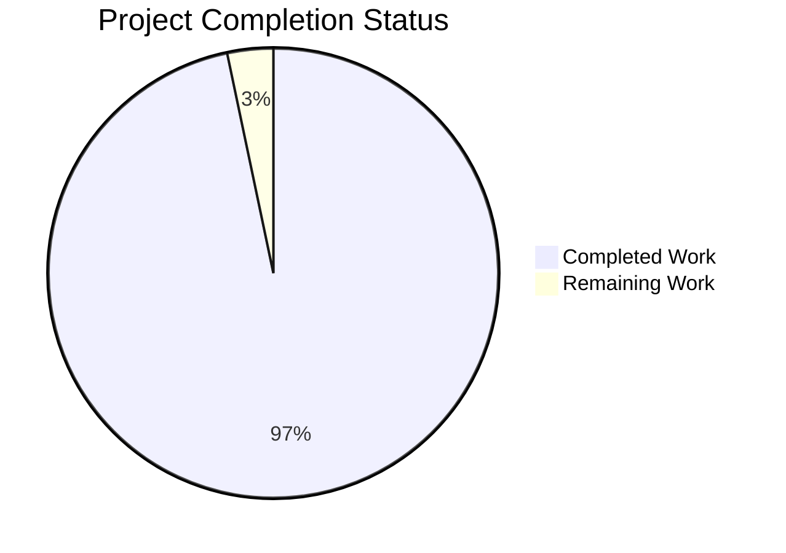

# 1. Executive Summary

A dependency-free Node.js HTTP server in three files, with one served route and a fixed plain-text fallback, built to be read as much as run.

## 1.1 Project Overview

The whole deliverable is three files at the repository root: `server.js` (134 lines), `package.json` (seven fields, no dependency key, engine floor `>=22.12.0`) and `README.md` (181 lines, eight sections). `GET /hello` returns `200` with `Content-Type: text/plain` and the body `Hello world`; every other request returns `404` with `Not Found`. No framework, middleware or dependency is involved, and the audience is a developer learning Node.js HTTP fundamentals.

## 1.2 Completion Status



| Metric | Hours |
| --- | --- |
| Total Hours | 45.5 |
| Completed Hours (AI + Manual) | 44.0 |
| Remaining Hours | 1.5 |

**97% complete** — 44.0 of 45.5 total project hours (44.0 / 45.5 × 100 = 96.70%, reported as 97%). Completed covers every deliverable the specification defines, the acceptance runs that prove them, the declared runtime floor and the documentation pass; the rest is costed in 1.4 and 2.2.

## 1.3 Key Accomplishments

- `GET /hello` answers `200` with `Content-Type: text/plain` and an 11-byte `Hello world` body, verified over curl, raw sockets and a browser
- Every other request — unknown paths and method mismatches alike — answers `404` with a 9-byte `Not Found`, and a query string does not defeat the match
- One ISO-8601 line per request is written before routing, carrying the method and the request target as received
- An invalid `PORT`, an occupied port and `CTRL+C` each behave as documented, with exit status `1`, `1` and `0`
- The declared floor reads `>=22.12.0` in the manifest, `Node.js v22.12.0 or later` in the README and no floor value in the source comment

## 1.4 Critical Unresolved Issues

**12 open items of the 36 requirements tracked for this project.** None blocks the two routes; the first three are the ones to settle before this is treated as a release.

| Issue | Impact | Owner | ETA |
| --- | --- | --- | --- |
| The declared engine floor is a declaration, not enforcement: npm reports a mismatch as `EBADENGINE` and the process still starts (1 item) | An operator on an unsupported runtime gets no hard failure, and the shutdown timing that runtime needs is never confirmed | Operator | Before choosing a production runtime |
| Neither the declared floor's own lower bound (v22.12.0) nor a second supported runtime line nor a non-Linux host has been exercised, and the declared range excludes the Node 20.x line (1 item) | Every acceptance figure belongs to one runtime line on one platform | Codebase owner | Before release on another platform |
| No automated regression suite can exist under the zero-dependency mandate (1 item) | Edits to the three files have no automated guard; the documented command set is the only check | Codebase owner | With any pipeline added outside the repository |
| The server binds every network interface and has no authentication, by design and disclosed at `README.md:52` (1 item) | Any host that can reach the machine on the chosen port can call both routes | Operator | Before exposing beyond a trusted network |
| No request timeouts, connection limits or rate limiting exist (1 item) | A slow client can hold a socket open and consume a descriptor until it disconnects | Operator | Before exposing beyond a trusted network |
| Both type-guarded connection sweeps are unreachable on any runtime the declared floor admits, and their comment now explains the guard rather than a floor relationship (1 item) | Redundant checks stay in the shutdown path, and their rationale and the code have drifted apart | Codebase owner | Next maintenance window |
| The generic bind-failure line (`server.js:78`) and the close-failure line (`server.js:95`) are reached only by fault injection and are not quoted in the README (1 item) | A reader who meets one of those failures finds no documented symptom | Codebase owner | Next documentation pass |
| A `HEAD` response and an HTTP/1.0 close-delimited response carry no `Content-Length` (1 item) | A client that insists on reading a body waits for its own timeout | None — accepted runtime behaviour | N/A |
| Requests the runtime's HTTP parser rejects (`400`/`431`) never reach the listener, so they produce no request log line (1 item) | The log records every request the application receives, not every byte on the socket | None — accepted runtime behaviour | N/A |
| A `SIGINT` delivered in the first milliseconds, before the signal listener is installed, terminates the process by default disposition with no output (1 item) | A supervisor that signals immediately after spawn can observe a silent stop | None — accepted runtime behaviour | N/A |
| Under a burst of fresh connections a single interleaved sample can spike far above the warm-connection figure — 78.9 ms and 86.4 ms observed while the median stayed unchanged (1 item) | The 10 ms target is a warm-connection figure rather than a worst case during connection storms | Codebase owner | With any sizing beyond local use |
| The per-request line writes the request target verbatim, so a client influences part of the operator's terminal output (1 item) | Informational: the runtime's parser rejects CR/LF and control bytes, so no log line can be forged | Operator | Informational |

## 1.5 Access Issues

No access issues identified: no credential, secret, database or external service is required, and both routes are reachable on `localhost` after `node server.js`.

## 1.6 Recommended Next Steps

1. [High] Confirm the supported range: `>=22.12.0` also excludes Node 20.x — widen it in `package.json:10` and `README.md:13` if 20.x must be supported (decision only)
2. [Medium] Re-run the acceptance commands on a second supported runtime line, including v22.12.0 itself, and on a non-Linux host (1.0 h)
3. [Medium] Decide the fate of the two type-guarded connection sweeps, now redundant on the declared floor (decision only)
4. [Low] Document the two fault-injection-only failure lines in the README's Configuration section (0.5 h)

# 2. Project Hours Breakdown

## 2.1 Completed Work Detail

| Component | Hours | Description |
| --- | --- | --- |
| `package.json` manifest | 1.5 | Seven fields with their exact values, the empty package set expressed by the absent dependency key, the engine floor, and `main`/`scripts.start` pointing at the entry file |
| Server creation, listeners and startup sequence | 2.5 | `http.createServer(handleRequest)`, the bind-error listener registered before `listen`, the signal listener installed before serving, and the confirmation emitted only from the listening callback |
| `GET /hello` route and the shared response path | 2.0 | One helper sets the status, the single `Content-Type` header and the body for both response shapes, so no branch can set them differently |
| Catch-all `404`, method mismatch and pathname resolution | 3.0 | An exact method-and-pathname match behind a pathname parse that tolerates a query string and answers the fixed `404` for every other target |
| Per-request logging | 1.0 | One ISO-8601 line per request on stdout, written before the path is resolved and before any handler runs, carrying the target as received |
| `PORT` rule | 3.0 | Default for unset, empty or whitespace-only; a single trim; digits only; inclusive `1024`–`65535`; privileged ports refused by the floor before any bind attempt; one actionable message per refusal |
| Bind-failure reporting | 2.0 | The occupied-port line naming the port and a concrete next step, the generic form for every other bind failure, exit status `1` and no stack trace |
| SIGINT shutdown path | 4.0 | Close, the two guarded connection sweeps, the idempotence guard, the two shutdown lines in order, and exit status `0` set rather than forced |
| `README.md` documentation | 4.5 | Eight sections in order with literal commands and expected outputs a reader with no prior knowledge can follow end to end |
| Reported security finding disposition | 1.5 | The finding assessed against the deliverable, determined not to apply to it, and verified as an absence of every surface it names, with nothing added for it |
| Acceptance runs and runtime verification | 8.5 | Contract, logging, latency distribution, concurrency, memory and descriptor stability, the port matrix, both bind failures, the shutdown matrix, `npm start`, the documentation greps and the browser pass |
| Deliverable-set discipline and hygiene | 1.5 | Exactly three files, zero declared packages, no lockfile or `node_modules`, no placeholder or trailing-whitespace marker and no dead code |
| Declared runtime floor, stated once and coherently | 4.0 | The floor raised to `>=22.12.0` in the manifest, in the README prerequisite and in the comment above the connection sweeps, with the three sites checked against each other and against the installed runtime |
| Documentation completeness pass | 1.0 | The query-string example in the Testing section and the occupied-port example in the Configuration section, both quoting output taken from the code and re-executed against a running server |
| Close-failure branch verification | 2.0 | The `Failed to close server: <message>` branch reached deterministically by a probe that makes the close report an error, with its line observed on stderr and its exit status confirmed |
| Shutdown-path departure records | 1.0 | The two recorded departures checked against the code and confirmed to describe it — the guarded connection sweep and the module-level shutdown flag |
| Review-guidance disposition | 1.0 | The project notes produced and consulted, and every item they carried dispositioned: implemented, closed by evidence, or recorded as unperformable on this host |
| **Total** | **44.0** | Matches Completed Hours in 1.2 |

Hours are counted only for the deliverables the specification defines for this three-file server and for the path-to-production work that follows from them. Nothing outside that scope — build pipelines, containers, monitoring, health endpoints, extra routes, databases, authentication — is counted, because none is part of this project.

## 2.2 Remaining Work Detail

| Category | Hours | Priority |
| --- | --- | --- |
| Cross-runtime and cross-platform re-verification: re-run the documented acceptance commands on a second supported runtime line — including the declared floor's own lower bound, v22.12.0 — and on a non-Linux host | 1.0 | Medium |
| Documentation completeness: quote the generic bind-failure line (`server.js:78`) and the close-failure line (`server.js:95`) in the README's existing Configuration section, where a reader troubleshooting either failure would look | 0.5 | Low |
| **Total** | **1.5** | Matches Remaining Hours in 1.2 and the "Remaining Work" slice in Section 7 |

**Basis of the calculation.** The completed figure is the sum of the component estimates above, each traced to a deliverable the specification defines or to the path-to-production work that follows from it, and each corroborated by the delivered code (334 lines across the three files) and by the acceptance runs the specification requires. The remaining figure is the sum of the two outstanding items; the twelve open items listed in 1.4 that are accepted runtime behaviour, accepted design or decisions rather than engineering are not costed, and nothing outside the project's scope is included. Completion = 44.0 completed ÷ 45.5 total = **97%**.

# 3. Test Results

The project ships no test framework and may not add one — the manifest declares zero packages and the deliverable set is fixed at three files — so the suite is the set of documented acceptance commands in Appendix A, run by hand. Every number below was produced by running those commands against the delivered tree: 76 assertions and probes across eight categories, none of which failed. No figure here is an estimate.

| Area / Category | Framework | Tests | Passed | Failed | Coverage | What This Proves |
| --- | --- | --- | --- | --- | --- | --- |
| HTTP contract and routing | `curl` + shell assertions | 19 route, method and byte assertions | 19 | 0 | Not measured — no coverage tool may be installed | `GET /hello` answers `200`/`text/plain`/11 bytes, every other request answers `404`/`text/plain`/9 bytes, and a query string does not defeat the match |
| Per-request logging | `curl` + a format grep on the capture | 20 assertions over two passes (3,267 further lines under load) | 20 | 0 | Not measured | One ISO-8601 line per request, in arrival order, written before routing, carrying the target as received |
| Configuration and port validation | shell exit-status gate | 12 cases (3 accepted, 9 refused) | 12 | 0 | Not measured | The default, the trim rule, the accepted bounds and the refusal of privileged ports, each with one actionable line and no bind |
| Bind-failure reporting | shell gate + a controlled holder + a fault-injection probe | 2 cases (occupied port, close failure) | 2 | 0 | Not measured | Both message forms, exit status `1`, nothing bound and no stack trace |
| SIGINT shutdown | shell gate + raw-socket clients | 6 cases (no client, idle keep-alive, stalled head, zero-byte socket, repeated signal, npm process group) | 6 | 0 | Not measured | Two lines in order, connections closed, stderr empty and exit status `0` in every case |
| Startup, manifest and `npm start` | shell gate + JSON probe | 4 assertions | 4 | 0 | Not measured | The startup line appears only after a successful bind, the manifest holds exactly its seven fields, and `npm start` serves with no install step |
| Latency, concurrency and memory (N1–N3) | `node` probes (`node:perf_hooks` and the built-in `fetch`) | 200 latency samples, one 50-way burst, a 3,000-request memory series | All passed | 0 | Not measured | Worst warm sample 2.661 ms against the 10 ms target, 50 of 50 concurrent responses exact, resident memory and descriptors flat |
| Deliverable set, code hygiene and security posture | grep, JSON and `curl` probes | 10 sweeps and probes | 10 | 0 | Not measured | Three files only, no dependency, no dynamic evaluation, no file or process access, no document or search-protocol surface, and no request value reflected into a response |

**Not Covered.** These are the capabilities and behaviours no test above exercises, and what a human should check before relying on them:

- Behaviour at the declared floor's own lower bound, v22.12.0, and on any second runtime line or non-Linux host: every figure in this section belongs to Node v22.23.4 on Linux.
- The Node 20.x line, which the declared range now excludes: nothing here speaks to it.
- The generic bind-failure path (`server.js:78`) and the close-failure path (`server.js:95`) in ordinary operation: both were reached by fault injection rather than by a normal request path, so confirm them with a harness that forces the failure.
- Requests the runtime's HTTP parser rejects (`400`/`431`): they never reach the listener and produce no request log line.
- A `HEAD` response and an HTTP/1.0 close-delimited response carry no `Content-Length`; if those must be present, that is a new requirement rather than a defect in the current code.
- A signal delivered in the first milliseconds, before the signal listener is installed: default disposition, with no shutdown output.
- Concurrency under a burst of fresh connections: a single interleaved sample can spike while the median stays unchanged — 78.9 ms and 86.4 ms were observed once each during such a burst — so size anything beyond local use from a separate client process.

# 4. Runtime Validation & UI Verification

- ✅ Start-up and bind — `node server.js` prints `Server listening on port 3000` as the first line of stdout with nothing on stderr, and the confirmation appears only after a successful bind
- ✅ `GET /hello` — `200 OK`, `Content-Type: text/plain`, `Content-Length: 11`, body `Hello world` with no trailing newline, on the default port and on overrides
- ✅ Catch-all and method mismatch — `GET /invalid`, `GET /hello/`, `GET /HELLO`, `GET /Hello`, `GET /hello.json`, `GET /` and `POST`/`OPTIONS`/`PUT`/`HEAD` on `/hello` each answer `404` with the 9-byte `Not Found`, while `GET /hello?name=world` answers `200`
- ✅ Per-request logging — one ISO-8601 line per request in arrival order, including the query-string target, with nothing written on a failure path other than the single error line on stderr
- ✅ `PORT` handling — unset, empty and whitespace-only resolve to `3000`; a padded value trims to the number it wraps; `1024` and `65535` bind; `abc`, `80`, `1023`, `65536`, `3000.5`, `3000x`, `+3000`, `0` and `-1` each exit `1` with one actionable line and bind nothing
- ✅ Bind failures — an occupied port prints the actionable line naming the port and a next step, exit status `1`, nothing bound and no stack trace; the generic form for any other bind failure was reached by a fault-injection probe and behaves the same way
- ✅ `CTRL+C` shutdown — the two shutdown lines in order with exit status `0` when no client is connected, with an idle keep-alive client, with a stalled client holding an unterminated request, with a zero-byte connection, when the signal is delivered repeatedly and when it reaches `npm start`'s process group
- ✅ `npm start` — the script serves `200` on the configured port with no install step, prints npm's banner ahead of the startup line, and creates neither `node_modules` nor a lockfile
- ✅ Browser rendering — both routes load in a real browser as plain text (`200` `Hello world` and `404` `Not Found`), the pages carry zero scripts, no JavaScript error or uncaught exception occurs, no error interstitial appears for the `404`, and every request in the session is same-origin (the browser's only automatic request, `/favicon.ico`, was answered by the documented catch-all)
- ⚠ Not exercised at runtime — the declared floor's own lower bound v22.12.0 and any second runtime line or non-Linux host; and the two fault-injection-only failure paths in ordinary operation

# 5. Compliance & Quality Review

The deliverable is held against the project's own specification and against the engineering standards that govern a zero-dependency, single-file Node.js service: built-in modules only, no dynamic evaluation, no file or child-process access, fixed response literals, one actionable message per failure, and no scope beyond the three files.

## 5.1 Compliance Matrix

| Deliverable / Requirement Area | Benchmark | Status | Evidence |
| --- | --- | --- | --- |
| Functional behaviour F1–F10 (bind, both responses, method mismatch, logging, startup line, shutdown, bind errors, `PORT` rule, `npm start`) | Every stated behaviour implemented at its stated value | ✅ PASS | `server.js:53-71`, `:73-113`, `:115-134`, `package.json:6-8`; each behaviour exercised at runtime |
| Non-functional N1–N3 (latency under 10 ms, concurrency without blocking, stable memory) | Measured, not assumed | ✅ PASS | 200-sample probe with a worst warm sample of 2.661 ms; 50 of 50 concurrent responses exact; resident memory and descriptors flat over 3,000 requests |
| N4 — built-in modules only, no framework, no package | One import; empty declared package set | ✅ PASS | Single `require('node:http')` at `server.js:3`; no dependency key; no lockfile or `node_modules` |
| N5 — no internal error detail in any response | Both bodies are fixed literals | ✅ PASS | `server.js:9-10`, `:43-47`; error text only to `console.error`; a probe carrying markup in the query string returned the fixed literal |
| N6 — production-ready files, no placeholder content | No `TODO`/`FIXME`/`PLACEHOLDER`, no dead code, no trailing whitespace | ✅ PASS | Sweeps clean across all three files; `node --check server.js` exits `0` with no output |
| N7 — naming, structure, comment budget, nothing unused | Purpose-revealing names, separate route handler, only non-obvious comments | ⚠️ PASS WITH CAVEAT | `server.js:16-113` holds the specified names and exactly four comments; the module-level shutdown flag at `:14` is the recorded departure in 5.2 |
| Configuration validation and failure reporting | One actionable message per failure, no silent fallback, no stack trace | ✅ PASS | `server.js:16-37`, `:73-82`, `:115-120`; nine refused values, the occupied-port line and the fault-injected generic form, each exit status `1` |
| Graceful shutdown contract | Two lines in order, connections closed, exit status `0` | ✅ PASS | `server.js:84-113`; verified in four client states, under a repeated signal and across `npm start`'s process group |
| Manifest metadata and run contract | Seven fields with exact values, runnable with no install step | ✅ PASS | `package.json:1-19`; `npm start` serves `200` and creates no install artifact |
| Declared runtime floor | One coherent floor in the manifest, the README and the guard comment | ✅ PASS | `package.json:10`, `README.md:13`, `server.js:105`; no `18.x` reference remains in any of the three files, and the installed v22.23.4 satisfies the range |
| Documentation deliverable | Eight sections in order, literal commands, outputs quoted accurately | ✅ PASS | `README.md:5-181`; every quoted value re-executed byte for byte, including both examples added during this change |
| Security boundaries and the reported finding | No reflection, no dynamic evaluation, no file or process access; the finding dispositioned with nothing invented for it | ✅ PASS | `server.js:3` and the absence sweeps; zero declared packages; Linux runtime; no patch step, scanner or manifest field added |

## 5.2 AAP & Rule Divergences and Gaps

| What the AAP/Rule Required | What Was Delivered Instead | Why It Diverged | Impact | Remediation |
| --- | --- | --- | --- | --- |
| The declared runtime floor stays exactly as the specification states it, `>=18.0.0`, and is not raised; the manifest field, the README prerequisite and the plan's own statement of the floor all carry that value | `engines.node` is `">=22.12.0"` (`package.json:10`), the README prerequisite reads `Node.js v22.12.0 or later` (`README.md:13`), and the comment above the connection sweeps asserts no floor value (`server.js:105`) | The owner's change request for this work directed the declared floor to be raised to a supported line, and the runtime this work is verified on is v22.23.4 on the 22.x line | **Sanctioned** — the declaration no longer names an end-of-life line and all three sites agree; the accepted range now excludes the Node 20.x line | None. Decide whether 20.x must also be supported and widen both sites if so |
| Each README section carries exactly its enumerated content, and the Testing and Configuration sections were settled as complete without the query-string and occupied-port examples | The Testing section carries a fourth worked example (`README.md:82-88`) and the Configuration section carries the occupied-port example (`README.md:175-181`), both inside the existing sections, with the eight-section structure, order and single documentation file unchanged | The owner's change request directed both examples to be added to those two sections, and each documents behaviour the code already has | **Sanctioned** — a reader now finds a worked example for the query-string route match and for a busy port | None |
| Node APIs newer than the declared floor are feature-detected rather than assumed, and the guard exists because of that floor relationship | Both type-guarded connection sweeps are retained unchanged (`server.js:106-112`), and the comment above them states only that each call is checked before it is made (`server.js:105`) | The raised floor guarantees both methods, but the guards were kept deliberately: removing them would change delivered shutdown behaviour | **Sanctioned** — two redundant property checks remain in the shutdown path, and their rationale and the code no longer describe the same reason | Decide at a maintenance window whether to retire them or keep them defensively; no change today |
| Shutdown closes idle connections through the single feature-detected sweep the implementation specification enumerates | A second guarded sweep closes every connection as well (`server.js:110-112`) | The same specification's shutdown contract — connections closed cleanly, exit status `0`, shutdown must not depend on connection luck — cannot be met for a connection whose request has not completed without it | **Sanctioned** — a client that connected without finishing a request can no longer hold the process open after `CTRL+C`; no timeout, connection limit, message or force-exit was added | None; the decision is recorded and the code needs no change |
| No module-level value beyond the constants is introduced, and there is no global state | One `let shuttingDown = false` binding (`server.js:14`) with a guard at the top of the signal handler (`:85-89`) | The exit-status-`0` contract under a repeated `CTRL+C`: the state-free alternative leaves the second signal to the default disposition and exits `130` with no output at all | **Sanctioned** — a repeated `CTRL+C` keeps exit status `0` and does not re-log the shutdown line | None; the decision is recorded and the code needs no change |
| The project's review instruction directs the project notes to be consulted and their guidance followed even where it goes beyond the original request | Only the notes items that add no feature, no file and no dependency were taken up — the declared floor and the two README examples; the rule's obligations for how the work is conducted and reported were met in full | The owner's instruction that this change must not expand scope bounds the rule's reach over the deliverable, and that instruction outranks the rule | **Sanctioned rule override** — the deliverable set stays three files, and no item of the notes required a feature, a file or a dependency | None |
| Verification runs use the host's per-instance port allocation and never sustain a hold on a port another instance owns | Instances ran on ports probed free in the ephemeral range rather than a published per-instance allocation, and one instance held the documented default port beyond its single permitted case, so three default-resolution cases were observed through the occupied-port path instead of as listeners | The documented default port was contended by other work running on the same host while these runs were in progress | No delivered byte is affected; three listener cases lost their direct form and their default resolution was instead observed through the binding failure that names port `3000` | None in the repository. Run discipline for any re-run: every instance inside its own allocation, the single default-port window released inside its case, and the end-of-run port sweep taken last |

**The declared runtime floor needs a decision (row 1, 60–120 words).** The manifest promises `>=22.12.0` and the README prerequisite says the same, so the two agree with each other, with the guard comment in `server.js:105` and with the installed runtime — `grep` finds no `18.x` reference left in any of the three files. What the owner must settle is whether a range narrower than the tooling this work ran under serves the intended audience: the 20.x line is excluded by a value that one edit in `package.json:10` and one line in `README.md:13` would widen. Nothing else depends on the choice, and the acceptance evidence in Section 3 belongs to the 22.x line either way.

**The retained connection sweeps need a decision (row 3, 60–120 words).** Both sweeps stay behind `typeof` checks (`server.js:106-112`) even though every runtime the declared floor admits provides them, so the checks are redundant in practice and the comment above them now explains the guard rather than a floor relationship. They were kept deliberately, because removing them is a behaviour change to the shutdown path, and the exit-status-`0` contract is the promise this file makes most loudly. The owner's choices are to retire them and simplify the shutdown path, or to keep them as defensive code and say so in that comment. Either is defensible; leaving the present state unexamined is not.

**The extra guarded connection sweep stands as recorded (row 4, 60–120 words).** Beyond the single feature-detected sweep the specification enumerates, the shutdown path also calls a guarded `closeAllConnections()` (`server.js:110-112`). It exists for the one connection state the enumerated sweep cannot reach: a client that connected without finishing its request. Without it, such a client holds the process open past `CTRL+C`, which would break the two-line shutdown and the exit status `0` that Sections 3 and 4 both exercise. The addition brings no timeout, no connection limit, no new message and no force-exit — a stalled client simply cannot hold the process open. Confirm the departure still stands so a later reader does not mistake it for drift.

**The module-level shutdown flag stands as recorded (row 5, 60–120 words).** `let shuttingDown = false` (`server.js:14`) with its guard at `:85-89` is the only module-level state beyond the constants and the server object. It exists so that a repeated `CTRL+C` during shutdown does not re-log the shutdown line, does not drive `server.close` onto an already-closed handle, and does not overwrite the clean exit status `0`. The alternative that adds no state — a one-shot signal listener — leaves the second signal to the default disposition and exits `130` with no output at all, trading a two-line addition for a worse operational outcome. No code change is needed; the record is what keeps it from being read later as an accidental global.

**The verification-environment departures need no change (row 7, 60–120 words).** Part of the work ran on ports probed free in the ephemeral range rather than inside a published per-instance allocation, and one of those instances held the documented default port beyond its single permitted case. The consequence is confined to the verification record: three default-resolution cases appear as bind failures naming port `3000` instead of as listeners, which is why Section 3 costs that much again rather than claiming them. No delivered byte is affected and nothing in the repository should change in response; a re-run of those three cases on a quiet host is all that is owed.

# 6. Risk Assessment

Risks here are forward-looking: what could still go wrong once this server is run, extended or exposed. No integration risk exists, because the deliverable consumes no external contract, calls no service, holds no credential and stores nothing.

| Risk | Category | Severity | Probability | Mitigation | Status |
| --- | --- | --- | --- | --- | --- |
| The declared engine floor is a declaration, not enforcement: npm reports a mismatch as `EBADENGINE` and the process still starts, so an operator on an unsupported runtime gets no hard failure | Technical | Low | Low | Verify the server on the runtime you intend to deploy against, or enforce the range outside this repository, where a configuration file is permitted | Open |
| No automated regression suite can exist under the zero-dependency mandate, so later edits to the three files have no automated guard | Technical | Medium | Medium | Run the documented command set in Appendix A in whatever pipeline is added outside this repository | Open |
| Both type-guarded connection sweeps are unreachable on any runtime the declared floor admits, so a regression in them would go unnoticed and their rationale no longer matches the code | Technical | Low | Low | Retire or re-justify them when the declared floor is next revised | Open |
| Shutdown and keep-alive behaviour at the declared floor's own lower bound (v22.12.0) and on any second runtime line or non-Linux host is unmeasured | Technical | Low | Low | Run the documented shutdown matrix on the intended runtime before relying on its timing | Open |
| `listen` passes no host, so the server binds every interface with no authentication: any host that can reach the machine on the chosen port can call both routes | Security | Medium | Medium | Keep it on a trusted network, or put a firewall or proxy in front; the exposure is disclosed at `README.md:52` | Accepted by design |
| No request timeouts, connection limits or rate limiting exist, so a slow client can hold a socket open and consume a descriptor until it disconnects | Security | Medium | Low | Front the server with a proxy that applies timeouts if it is ever exposed beyond localhost | Accepted by scope |
| The per-request line writes the request target verbatim, so a client controls part of the operator's terminal output | Security | Low | Low | Node's parser rejects CR/LF and control bytes, so no log line can be forged; avoid piping these logs to a terminal that honours escape sequences | Informational, accepted |
| One process and one event loop, with no clustering, and a single interleaved sample can spike far above the warm-connection figure during a burst of fresh connections (78.9 ms and 86.4 ms observed while the median stayed unchanged) | Operational | Low | Low | Keep the request handler free of I/O and heavy computation, and size anything beyond local use from a warm-connection baseline rather than the worst sample | Open |

Two runtime behaviours are accepted rather than risked: a `HEAD` response and an HTTP/1.0 close-delimited response carry no `Content-Length`, and a `SIGINT` delivered before the signal listener is installed ends the process by default disposition with no output.

# 7. Visual Project Status


Completed work is shown in dark blue (`#5B39F3`) and remaining work in white (`#FFFFFF`). The chart's two values are the completed and remaining hours in Section 1.2.

Remaining hours by category, from Section 2.2:

| Remaining category | Hours | Priority |
| --- | --- | --- |
| Cross-runtime and cross-platform re-verification | 1.0 | Medium |
| Documentation completeness for the two fault-injection-only failure lines | 0.5 | Low |
| **Total** | **1.5** | — |

# 8. Summary & Recommendations

The project delivers what it set out to deliver: a minimal, dependency-free Node.js HTTP server in three files, with one hand-written route, an explicit fallback for everything else, per-request logging in a fixed format, a validated `PORT` whose own floor refuses privileged ports, actionable reporting for both kinds of bind failure, and a shutdown that closes the server and its connections, prints two lines and exits with status `0`. Every one of those behaviours was exercised at runtime rather than assumed, and the measured margins are wide: a worst warm sample of 2.661 ms against a 10 ms target, fifty concurrent responses all exact, and resident memory plus descriptor counts flat across 3,000 requests. The browser sees the same thing the console does — plain text at both statuses, no client-side script, no cross-origin request.

**97% complete** — 44.0 of 45.5 total project hours (44.0 / 45.5 × 100 = 96.70%, reported as 97%). The delivered work now also covers the declared runtime floor and the documentation pass that were outstanding: `engines.node` reads `">=22.12.0"`, the README prerequisite matches it, the comment above the connection sweeps asserts no retired floor, and the Testing and Configuration sections each carry one more worked example inside the sections that already existed. The remaining 1.5 hours are not missing functionality: 1.0 hour re-runs the documented acceptance commands on a second supported runtime line — including the declared floor's own lower bound — and on a non-Linux host, and 0.5 hour quotes the generic bind-failure and close-failure lines in the README's Configuration section, where a reader troubleshooting either failure would look.

The one item worth settling first is the declared range itself. The manifest and the README now agree on `>=22.12.0`, which is a supported LTS line and the line this work was verified on, but it also excludes the Node 20.x line the run's own tooling permits. That is a choice rather than a defect, and it is a one-value edit in `package.json:10` plus one line in `README.md:13` if the audience includes 20.x. Two smaller decisions belong beside it: the two type-guarded connection sweeps are unreachable on any runtime the declared floor admits and were kept deliberately, so their fate should be settled rather than left implicit; and the two shutdown departures — the extra guarded sweep and the module-level shutdown flag — are recorded in 5.2 and need only confirmation that they stand.

For an operator, the practical picture is simple: `node server.js` or `npm start` starts it, `PORT` moves it, `CTRL+C` stops it cleanly, and the two endpoints behave exactly as `README.md` describes. Three cautions belong in the runbook. The server binds every network interface with no authentication, so on a shared network it should sit behind a firewall or proxy that also supplies the request timeouts and connection limits the application deliberately does not implement. The declared floor is a declaration rather than enforcement, so the runtime should be pinned in the deployment rather than relied on to be refused. And the 10 ms response target is a warm-connection figure: during a burst of freshly opened connections a single interleaved sample can spike well above it while the median stays unchanged.

Success for this codebase is a beginner reading `server.js` end to end and following one request from the socket to the response, and a reviewer running the documented commands and getting the documented outputs. Both hold today, with the two routes verified over curl, raw sockets and a real browser, and 76 acceptance assertions and probes passing without a failure. Production readiness for the intended use — a local teaching server — is therefore high, with the range decision, the guard decision and the cross-runtime re-run as the only items that should be settled before this code is treated as a stable release rather than a verified artifact.

# 9. Development Guide

## System prerequisites

- Node.js v22.12.0 or later — the floor the manifest declares and the README's single prerequisite. Check it with:

```bash
node --version
```

- A shell, and `curl` for the verification steps. Nothing else: no database, no cache, no service, no credential and no environment variable is required.
- Run every command from the repository root, the directory that holds `server.js`, `package.json` and `README.md`.

## Environment setup

There is none. The three files are the whole project, so cloning or copying the repository is the entire setup. `PORT` is the only optional environment variable: leave it unset and the server binds `3000`.

## Dependency installation

None. The manifest declares no `dependencies` and no `devDependencies` key, so there is nothing to resolve and no lockfile or `node_modules` to manage — do not run `npm install`, which would create a lockfile this project must not carry, and do not add a package for tests, linting or coverage, which the zero-dependency constraint forbids. `npm start`, one of the two run commands, ships with Node.js itself.

## Application startup sequence

Run either command from the repository root:

```bash
node server.js
```

```bash
npm start
```

Both bind port `3000` by default, both keep running in the foreground, and neither needs an install step. The server prints its startup confirmation as the first line of its own output; under `npm start`, npm's banner (a blank line, then `> nodejs-tutorial-hello-world@1.0.0 start` and `> node server.js`) precedes it:

```bash
Server listening on port 3000
```

To bind another port, set `PORT` for the command:

```bash
PORT=4000 node server.js
```

The startup line then names the port that was bound (`Server listening on port 4000`). Values padded with whitespace are trimmed, so `PORT=' 4000 '` binds `4000`; the accepted range is `1024` to `65535` inclusive; unset, empty or whitespace-only takes the default `3000`.

## Verification steps

With the server running in one terminal, run these in a second one. The `-i` option makes `curl` print the status line and headers as well as the body.

```bash
curl -i http://localhost:3000/hello
```

Expect `HTTP/1.1 200 OK`, `Content-Type: text/plain`, `Content-Length: 11` and the body `Hello world` with no trailing newline. Confirm the byte count and the route's tolerance of a query string:

```bash
curl -sS http://localhost:3000/hello | wc -c          # 11
curl -o /dev/null -w '%{http_code}\n' 'http://localhost:3000/hello?name=world'   # 200
```

Expect `404 Not Found` with the 9-byte body `Not Found` for any other path, and for the defined route requested with another method:

```bash
curl -i http://localhost:3000/invalid
curl -i -X POST http://localhost:3000/hello
```

Each request also writes one line to the server's console, the ISO-8601 timestamp, the method and the request target as received:

```bash
2026-11-09T14:24:24.749Z GET /hello
```

## Example usage

Every request is answered by one of exactly two responses, so a single client call exercises the whole contract:

```bash
curl http://localhost:3000/hello      # Hello world
curl http://localhost:3000/anything   # Not Found
```

The served route is a plain-text endpoint with no payload, no authentication and no session: the same call returns the same 11 bytes every time, and nothing from the request — its method, its target, any header — is echoed back in a response.

## Shutdown

Press `CTRL+C` in the terminal that is running the server (or send the same signal to the process). The server prints two lines in this order and exits with status `0`, closing its connections as part of the shutdown:

```bash
Received SIGINT, shutting down server
Server closed
```

Under `npm start`, send the signal to the process group — what `CTRL+C` reaches at a terminal — or to the server process itself; signalling only the npm wrapper leaves the server running.

## Troubleshooting

| Symptom | Cause | Resolution |
| --- | --- | --- |
| `Failed to start server: port 3000 is already in use. Stop the process using it, or choose another port, for example: PORT=3001 npm start` | Another process already holds the port; exit status is `1` and nothing was bound | Start on another port with `PORT=3001 node server.js`, or stop the process holding the port |
| `Failed to start server on port <port>: <message>` | A bind failure other than an occupied port — for example a resource limit | Read the message, free the resource, or choose another port; exit status is `1` and nothing was bound |
| `Configuration error: Invalid PORT value "abc": expected an integer between 1024 and 65535.` | `PORT` is not a plain integer in the accepted range; exit status is `1` and no server is created | Set `PORT` to a whole number between `1024` and `65535`, or unset it to use `3000` |
| The port below `1024` you asked for was refused as a configuration error | The application's own `1024` floor declines privileged ports before any bind attempt | Choose a port at or above `1024`; this is not an operating-system permission problem |
| `Failed to close server: <message>` | The server was not open when the shutdown ran, so the close reported an error; exit status is `1` | Nothing to do beyond reading the message: the process has already stopped accepting work |
| The startup line never appears under `npm start` | npm prints its own banner first, and the child's output follows it | Read the startup line by pattern rather than by position; if it is absent entirely, look for the single error line on stderr |
| A second `CTRL+C` produces no further output | The shutdown is already in progress and the handler ignores a repeated signal | Wait for `Server closed`; the process exits with status `0` on the first signal |
| `HTTP/1.1 404 Not Found` when you expected `Hello world` | The match requires the method `GET` and the pathname `/hello` exactly | Use `GET`, and spell the path `/hello`; a trailing slash, a different case or another method reaches the fallback by design |

# 10. Appendices

Supporting references for running, verifying and extending this three-file server.

## 10.1 Appendix A — Command Reference

| Purpose | Command | Expected result |
| --- | --- | --- |
| Check the runtime | `node --version` | `v22.12.0` or later |
| Check the source parses | `node --check server.js` | No output, exit status `0` |
| Start the server | `node server.js` | `Server listening on port 3000` |
| Start through the manifest | `npm start` | npm's banner, then `Server listening on port 3000` |
| Start on another port | `PORT=4000 node server.js` | `Server listening on port 4000` |
| Stop the server | `CTRL+C` in its terminal | `Received SIGINT, shutting down server`, then `Server closed`, exit status `0` |
| Served route | `curl -i http://localhost:3000/hello` | `200 OK`, `Content-Type: text/plain`, `Content-Length: 11`, body `Hello world` |
| Served route with a query string | `curl -o /dev/null -w '%{http_code}\n' 'http://localhost:3000/hello?name=world'` | `200` |
| Any other path | `curl -i http://localhost:3000/invalid` | `404 Not Found`, body `Not Found` (9 bytes) |
| Method mismatch | `curl -i -X POST http://localhost:3000/hello` | `404 Not Found`, body `Not Found` |
| Body byte count | `curl -sS http://localhost:3000/hello \| wc -c` | `11` |
| Invalid port | `PORT=abc node server.js` | `Configuration error: Invalid PORT value "abc": expected an integer between 1024 and 65535.`, exit status `1` |
| Occupied port | `PORT=3000 node server.js` while the port is held | `Failed to start server: port 3000 is already in use. …`, exit status `1` |
| Manifest field check | `node -e 'const p=require("./package.json"); console.log(Object.keys(p).join(","))'` | `name,version,description,main,scripts,engines,keywords` |
| Declared floor check | `node -e 'console.log(require("./package.json").engines.node)'` | `>=22.12.0` |
| Placeholder sweep | `grep -nE 'TODO\|FIXME\|XXX\|PLACEHOLDER' server.js package.json README.md` | No match |

## 10.2 Appendix B — Port Reference

| Port | Role |
| --- | --- |
| `3000` | The default the server binds when `PORT` is unset, empty or whitespace-only; the port every `README.md` example uses |
| `1024` | The lowest accepted value, inclusive — the floor that refuses privileged ports before any bind attempt |
| `65535` | The highest accepted value, inclusive |
| `1`–`1023` | Refused as a configuration error, exit status `1`, nothing bound |
| Any value the server cannot bind | Reported with one actionable line naming the port, exit status `1`, no stack trace |
| `4000` | Used only in the README's worked `PORT` override example; not special to the application |

## 10.3 Appendix C — Key File Locations

| Path | Contents |
| --- | --- |
| `server.js` | The whole application: constants (`server.js:5-10`), `resolvePort` (`:16-37`), `logRequest` (`:39-41`), `sendPlainText` (`:43-47`), `handleHello` (`:49-51`), `handleRequest` (`:53-71`), `handleServerError` (`:73-82`), `handleSigint` (`:84-113`), the startup sequence (`:115-134`) |
| `package.json` | The manifest: the seven fields, `main` and `scripts.start`, the engine floor, no dependency key |
| `README.md` | Purpose, Prerequisites, Installation, Running the server, Testing, Expected output, Shutdown, Configuration |
| Repository root | The only directory in the deliverable — there is no source tree, test directory, documentation directory or configuration directory |

## 10.4 Appendix D — Technology Versions

| Technology | Version | Notes |
| --- | --- | --- |
| Node.js — declared floor | `>=22.12.0` | Stated as `engines.node` in `package.json:10` and as the README's single prerequisite; a bare comparator range with no upper bound, so any later release line satisfies it. It documents the floor rather than enforcing it: npm reports a mismatch as an `EBADENGINE` warning |
| Node.js — runtime exercised | v22.23.4 | Every measurement reported in Section 3 belongs to this runtime |
| npm | 11.21.0 | Used only to run `npm start` |
| JavaScript / module system | ES2022 syntax, CommonJS (`require`) | No build step, no transpiler, no `"type"` field in the manifest |
| Built-in modules used | `node:http` | The only import in the project (`server.js:3`); `process`, `console`, `URL` and `Date` are runtime globals that need no import |
| Connection sweeps | `server.closeIdleConnections()`, `server.closeAllConnections()` | Both arrived in Node v18.2.0, so the declared floor guarantees them; each is still called behind a type check (`server.js:106-112`) |
| Declared packages | none | No dependency key of any kind; there is no lockfile to keep in step |

## 10.5 Appendix E — Environment Variable Reference

| Variable | Required | Default | Accepted values | Behaviour when invalid |
| --- | --- | --- | --- | --- |
| `PORT` | No | `3000` | A decimal integer from `1024` to `65535` inclusive; surrounding whitespace is trimmed, so `PORT=' 4000 '` binds `4000`; unset, empty or whitespace-only takes the default | One line on stderr, `Configuration error: Invalid PORT value "<value>": expected an integer between 1024 and 65535.`, exit status `1`, and no server is created |

No other environment variable is read. The project needs no secret, credential, token or connection string, and no `.env` file or configuration file exists or should be added — `server.js:116` is the only place the process environment is consulted.

## 10.6 Appendix F — Developer Tools Guide

| Tool | Role here | Notes |
| --- | --- | --- |
| `node` | Runs the application and the one-off probes used during verification | No build, transpile or bundle step exists; `node server.js` executes the source directly |
| `npm` | Provides `npm start` and reads the manifest | No install step runs; npm resolves zero packages, so no lockfile and no `node_modules` appear |
| `curl` | Exercises both routes and the failure paths | The README's verification commands are `curl` calls; `-i` prints the status line and headers |
| `git` | Version control for the three files | The delivered commit set is exactly `README.md`, `package.json` and `server.js` |
| A browser | Optional check that both responses render as plain text | The served content is text only: no HTML, no CSS and no client-side script exists to load |

Not to be added, because the project's constraints forbid them: a linter, formatter or type checker; a test runner or coverage tool; a bundler or transpiler; a lockfile; and any runtime dependency. Each would need a package install, and the deliverable set is fixed at three files — a change to the request handler is verified by running the documented commands in Appendix A and comparing their output.

## 10.7 Appendix G — Glossary

| Term | Meaning in this project |
| --- | --- |
| Route | A request the server answers deliberately: exactly `GET /hello` |
| Catch-all | The single fallback branch that answers every request the route does not match with `404 Not Found` |
| Pathname | The path part of the request target, resolved with the `URL` global so a query string cannot defeat the exact-path match (`server.js:60`) |
| Request target | The raw request line field the client sent, including any query string; it is what the per-request log records, exactly as received (`server.js:40`) |
| Startup confirmation | The line `Server listening on port <PORT>`, emitted only from the listening callback, so it never appears when a bind fails |
| Bind failure | A failure to claim the port: an occupied port (`EADDRINUSE`), or any other reason the runtime reports, each answered with one actionable line and exit status `1` |
| Idle connection | A keep-alive socket whose request cycle has finished but which is still open; the shutdown releases these as part of closing the server |
| Connection sweep | The guarded call that closes connections at shutdown — idle ones, and every remaining connection, so a client that never finished its request cannot hold the process open |
| Graceful shutdown | What `CTRL+C` triggers: close the server and its connections, print the two shutdown lines in order, exit with status `0` |
| Exit status | The process's final status: `0` after a clean shutdown, `1` after a configuration or bind failure |
| Engine floor | The minimum runtime the manifest declares, `>=22.12.0`, matched by the README prerequisite; it documents the supported floor rather than enforcing it |
| Plain-text response | A response body that is a fixed string with `Content-Type: text/plain` — there is no HTML, JSON or template anywhere in the project |
| Warm-connection figure | A latency measurement taken on an already-established connection, which is what the 10 ms target describes; a burst of freshly opened connections can show a single much higher sample |
